# 架构图反例库：从读者看不懂的地方倒查

本册整理当前会话中可见的用户反馈、附件及项目现有规则。不是对不可见历史的完整审计，也不是当前站点的缺陷清单。原始附件保留像素，不重新生成“仿真反例”；文件来源见 [图片清单](counterexample-assets.json)。

图注指出要看的位置。**一张图用于说明一个问题，不等于整张图的数学内容都错。** “讨论风险”来自用户提出的理解困惑，不能反过来声称旧图已经画出了某种错误连线。两张局部正例也只对照指定改法，不保证其余区域或所有交互合格。

本册负责“认出问题”；[结构语义契约](structure-semantics.md)与[布局契约](react-flow-layout.md)负责具体规则，避免在三处维护三套要求。脚本、截图和语义核对的分工见[检查方法](inspection-playbook.md)。

## 快速索引

| 类别 | 用户看到的症状 | 优先查哪里 |
| --- | --- | --- |
| [01 说明入框](#case-01) | “本层分数”“512维”跟变量挤在一起 | 数据框与说明的边界 |
| [02 空框长条](#case-02) | 一个符号占一大块，U 空而不展开 | 元素、矩阵、包装层三级尺寸 |
| [03 整体空旷](#case-03) | 两边空着，中间一根长柱 | 横排、分行、串并行依赖 |
| [04 用文字代替结构](#case-04) | 大段话、独立说明大块，看不进层内 | 主图与旁注的分工 |
| [05 分支与层级不清](#case-05) | 两个过程混在一起，不知谁依赖谁 | 分组边界、真实分流和汇合 |
| [06 过度拆算术](#case-06) | exp 也配小箭头，向量拆完再合 | 简单函数与真正归约的边界 |
| [07 溢出与公式排版](#case-07) | 末列越框、长公式挤成柱 | 子框、祖先框、实际数学边界 |
| [08 符号与拼接来源](#case-08) | u/U、O/C、k3t 看不懂 | 类型、索引、改名映射 |
| [09 颜色失去语义](#case-09) | 同一个 a 换色，选中行不显眼 | 全链路角色色与选择色 |
| [10 路由与端口](#case-10) | 从右边绕一大圈、线接空白 | 真实数据边界与合法短路径 |
| [11 本地缓存时间轴](#case-11) | 本层 KV 是否要拼上一层 KV？ | 本层历时更新与层间隐藏状态 |
| [12 全局缓存与跨层复用](#case-12) | Full 是否重算历史？复用到哪层？ | G、Key、ID 的分别溯源 |
| [13 Indexer 选择对象](#case-13) | 从哪里选？选分数还是选 Query？ | 候选池、分数、行号、原 G 行 |
| [14 Engram 黑箱与收益](#case-14) | 反量化是什么？到底少算了什么？ | 查表后的运算与真实成本 |
| [15 公共组件与可还原数据](#case-15) | 第二层好了，别的层仍旧；JSON 能还原吗？ | 复用边界与导出承诺 |
| [16 验收假阳性](#case-16) | 脚本绿，但图不对、截图区域也不对 | 目标身份、视觉复核、证据范围 |
| [17 交互与性能](#case-17) | 静态图没事，拖动后断线、卡顿 | 真鼠标、保存恢复、计时口径 |
| [18 入口与交付范围](#case-18) | 你到底改哪儿了？怎么又部署？ | 指定入口、版本、用户授权 |

## 01 · 说明文字占据了数据框

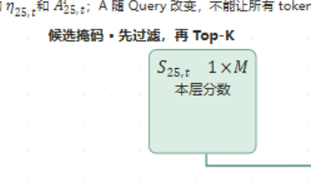

看绿色框：“本层分数”是解释，不是 S 的元素；下面的大块留白也没有表达数据。

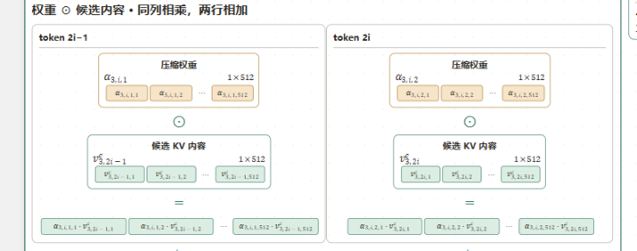

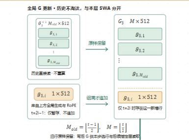

| 编号 | 反面模式 | 改法 |
| --- | --- | --- |
| 01.a | 把“本层分数”“候选 KV 内容”等中文职责写进数据框 | 短标题放框外，框内保留符号、维度及数据结构 |
| 01.b | 为说明再套一个外框，内层已经是完整数据对象 | 取消没有独立分组职责的包装框；说明在真实数据框外 |
| 01.c | 每一行内部重复“512维”“历史直接读” | 维度写矩阵标题角落；历史/新增/淘汰写外侧短标记 |
| 01.d | 说明移出后，符号框仍被旁边高说明区拉伸 | 同时解除数据框的纵向拉伸，按公式高度定高 |

这里的“框外”指**数据框外**。分支容器可以有简短阶段标题，矩阵标题可以有形状；不能把这条规则误解成删掉所有标题或把维度从矩阵标题赶走。

局部改法对照：说明在上方，S 的符号框收紧，后续过滤连接保留。

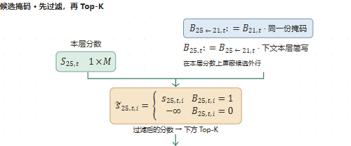

**检查：** DOM 比较说明与数据框的包含关系、上下边界和空余高度；人工看说明究竟属于哪一框。相关测试：`e2e/candidate-score-caption.spec.ts`、`e2e/compressor-structure.spec.ts`。规则归入[图形语法](structure-semantics.md#图形语法)。

## 02 · 元素被拉成长条，矩阵却没有展开

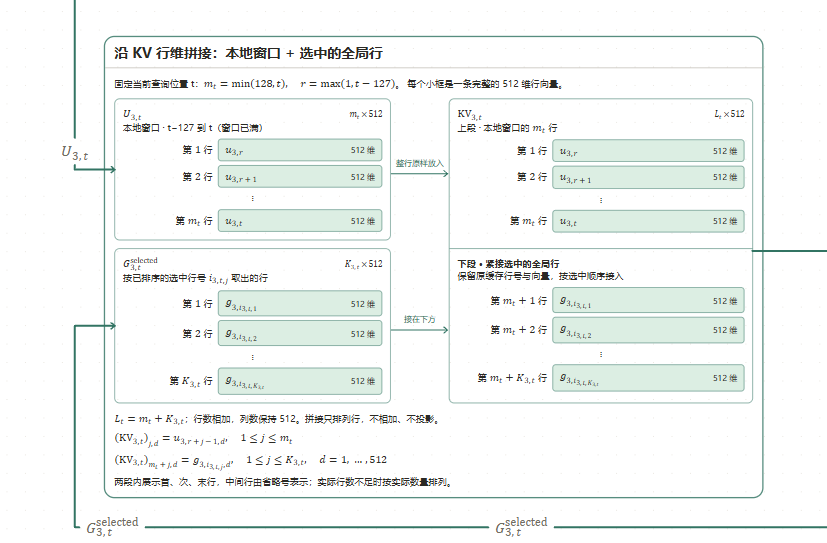

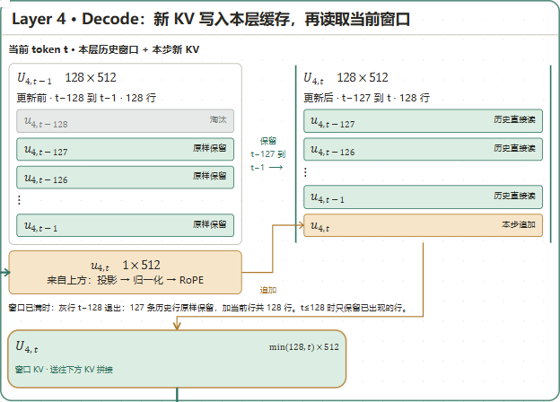

| 编号 | 反面模式 | 改法 |
| --- | --- | --- |
| 02.a | 单符号继承父栏宽度，变成长条或高柱 | 元素按实际公式和必要内边距定宽高，不以张量真实维度模拟比例 |
| 02.b | U、G 等大框留白很多，只写名称不画组成 | 展开代表行；空间允许时行内展开首、次、末元素与省略号 |
| 02.c | 上方已经画了更新后的窗口，底下又复制空 U 作出口 | 从现有窗口真实边界出线，不制造重复同名对象 |
| 02.d | 小格收紧了，矩阵、运算行和父模块仍保留原宽高 | 从元素到矩阵到运算组到模块逐级收紧，重测端口 |
| 02.e | 用缩字、隐藏溢出、删末项换取“紧凑” | 保持字号、代表项和连接净空；重分配空间 |

紧凑不等于所有框越小越好：向量和矩阵要容纳组成，独立数据通道要留空间。只有一个标量的框与容纳三条行向量的矩阵不能采用同一种缩框方式。

**检查：** 内容宽度候选扫描、父框加宽前后元素尺寸比较、同列对齐与高亮行同尺寸；人工判断大块空白是否承担走线用途。脚本阈值只是找候选，不能靠调成阈值以下逃避检查。相关测试：`e2e/content-width-audit.spec.ts`、`e2e/selected-matrix-size.spec.ts`、`e2e/parameter-height.spec.ts`。规则见[元素框按内容定宽](react-flow-layout.md#元素框按内容定宽)。

## 03 · 局部排列整齐，整个模块仍是空的

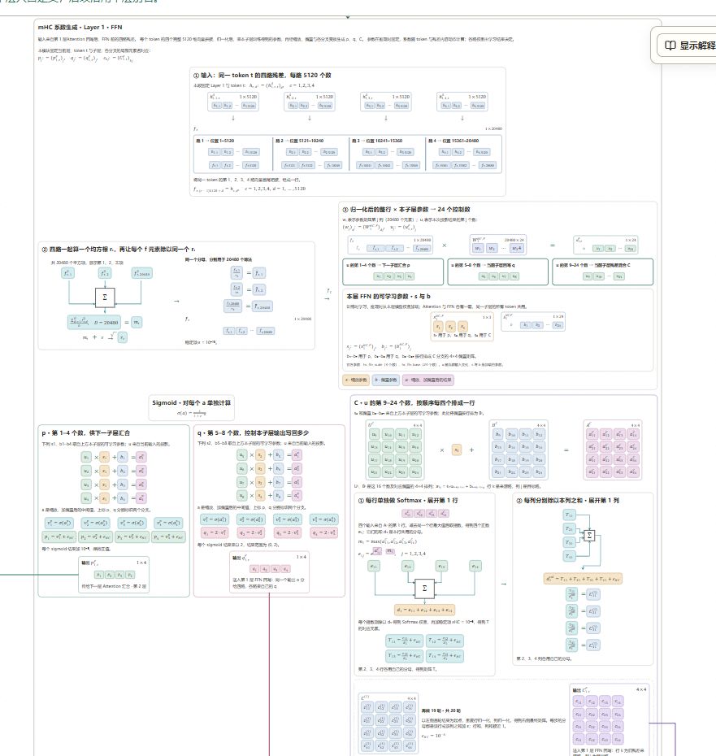

看上半部：①拼接与②归一化可在第一行相接，③投影独占第二行。**横排不等于并行**，①→② 的依赖线必须保留。

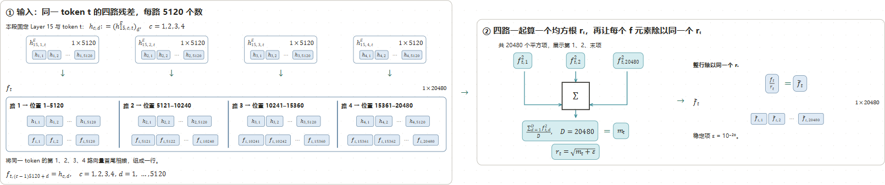

此对照图只截第一行①②；③位于截图范围外，不能用这张局部图证明整个模块的排版。

下面四张是同一根因的不同实例，不应分别打坐标补丁。

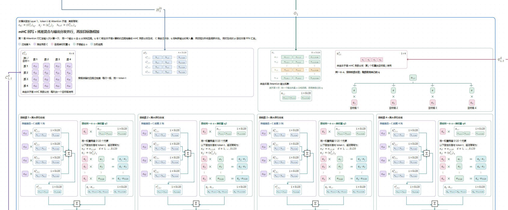

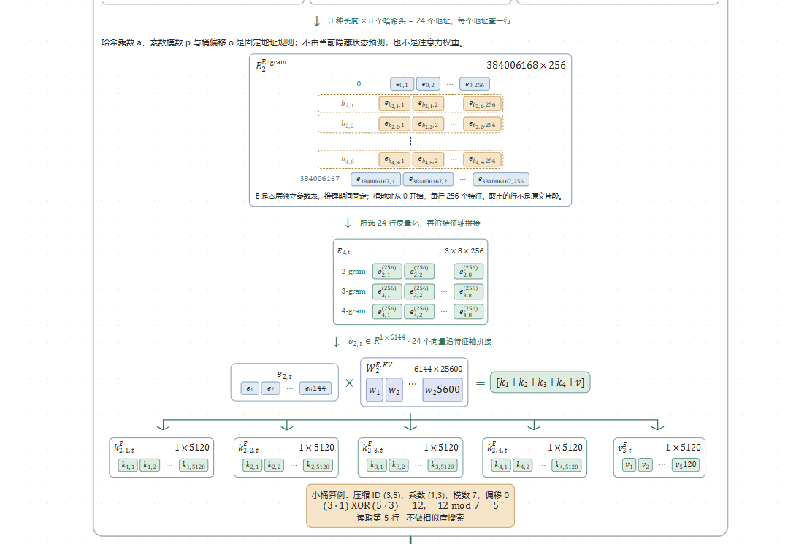

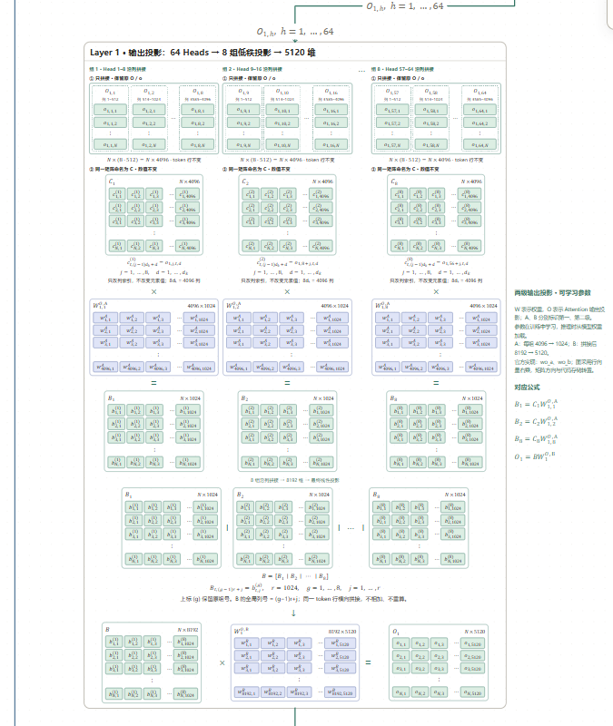

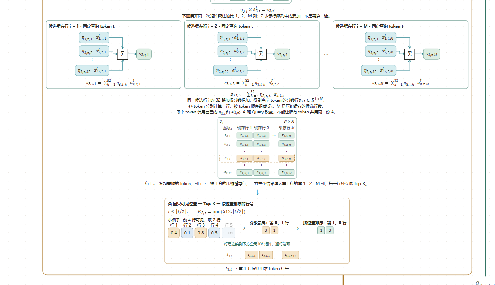

| 编号 | 反面模式 | 改法 |
| --- | --- | --- |
| 03.a | 短流程一律纵排，中间很高、两边很空 | 可读宽度足够时改为横向计算链，过长再分行 |
| 03.b | mHC ①②③按旧固定位置错落排 | 按数据依赖组织“第一行①②、第二行③”，下游分支再汇合 |
| 03.c | 并行分支等宽等高，短支路被长支路撑空 | 区域按内容分配；短支路结果靠近真正消费端 |
| 03.d | 重排内部后沿用旧模块高度和下游坐标 | 从实际子边界重算父边界、图高度和路径 |
| 03.e | 为填空增加重复矩阵或无关解释 | 直接减小空间或重排，不用新内容掩盖排版问题 |

**检查：** 测阶段相对位置、模块边界和宽窄屏包含关系；人工同时看全模块与细节，不能只看某一个小框。相关测试：`e2e/mhc-compact.spec.ts`、`e2e/mhc-output-compact.spec.ts`、`e2e/indexer-compact.spec.ts`、`e2e/compact-semantic-regression.spec.ts`。规则见[整页布局与宽度预算](react-flow-layout.md#整页布局与宽度预算)。

## 04 · 架构图变成说明书，还与本层脱节

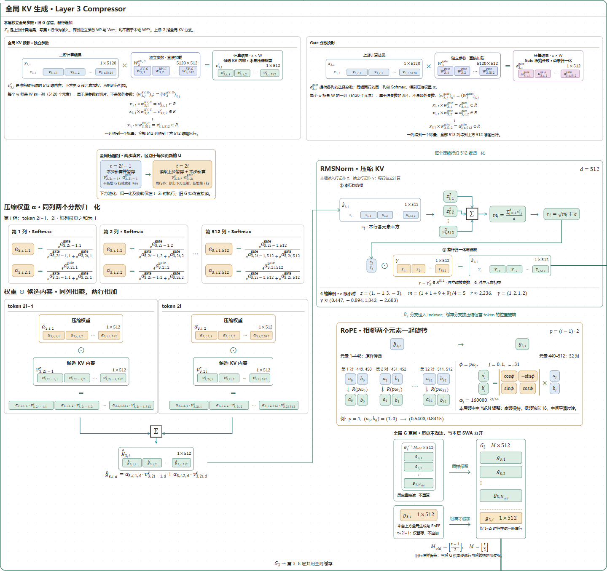

这里只看顶部：已经有“输入 × 参数 = 输出行”，再堆数条同构标量公式并没有增加结构。

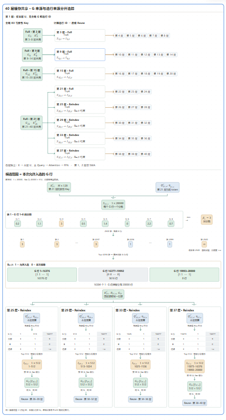

| 编号 | 反面模式 | 改法 |
| --- | --- | --- |
| 04.a | 主图用长段落解释数据流 | 主图保留对象、参数、维度、选择和连接；推导与例子放同步旁注 |
| 04.b | 一次投影下重复三条“行乘列”公式 | 主图用对应的代表列与输出元素表达；细推导进入解释面板 |
| 04.c | 新机制只在独立大块、表格或机制章节里出现 | 在本层实际生成/读取/消费位置嵌入同一组件；概览只辅助导航 |
| 04.d | 对话解释清楚，图仍保留旧含义 | 修改图与旁注中的同一符号链，沿图重新走通一次 |

**检查：** 脚本检查指定逐层入口中必要分支、参数、连接是否存在；文案长度扫描只用于定位，不能自动判定一段说明是否必要。人工问：“不读旁注，能否指出这个结果从哪里来、送往哪里？”相关测试：`e2e/layer-cache-inline.spec.ts`、`e2e/module-inspector.spec.ts`。不要为减少文字删掉真正缺失的计算。

## 05 · 两个分支看起来像一个，属于与流向混淆

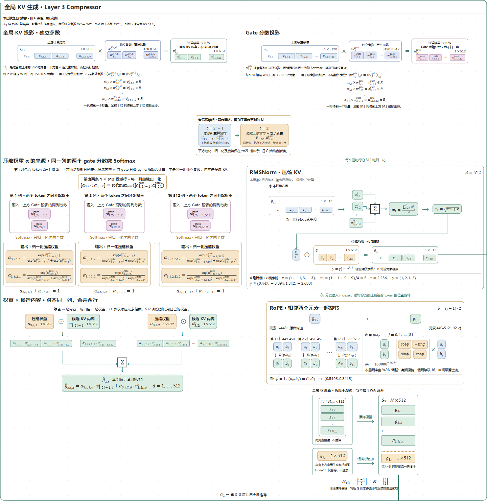

| 编号 | 反面模式 | 改法 |
| --- | --- | --- |
| 05.a | 两个独立投影只有标题，没有可辨边界 | 各有小分支框，分别展示输入、自己的参数和输出 |
| 05.b | 独立过程上下连成链；串行过程横排却没依赖线 | 并行按横向组织；串行无论方向都保留依赖 |
| 05.c | 以“在同一个框里”暗示已发生计算或数据传递 | 嵌套只表达组成，连线表达流向，算子表达运算 |
| 05.d | 分组外框当作多种内部结果的总出口 | 真实对象各有端口，分流和汇合能辨明输入输出 |

**检查：** 核对分支数、参数归属、Stage/links 和实际 handle；人工逐支追踪，确认旁路没有被误当主路。相关测试：`e2e/compressor-structure.spec.ts`、`tests/architectureBoundary.test.ts`。规则见[图形语法](structure-semantics.md#图形语法)与[内部小框端口](react-flow-layout.md#内部小框端口)。

## 06 · 把简单算术画成流水线

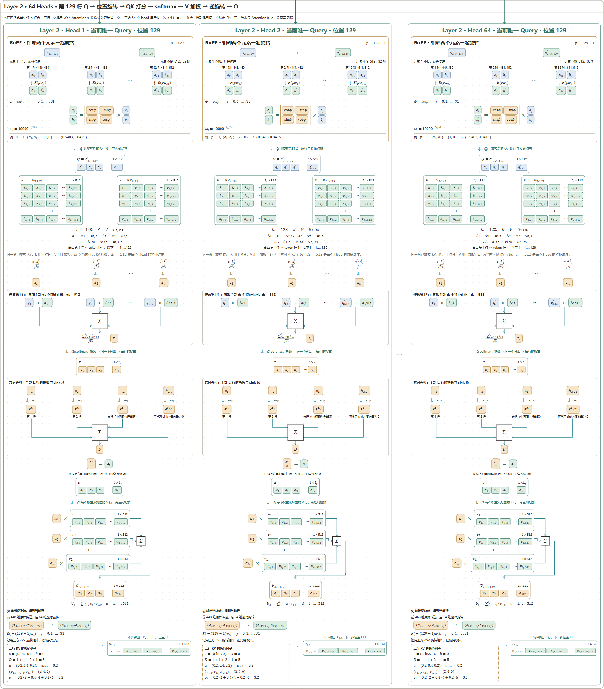

看 Softmax 分母区域的“↓ exp”，不是要求删掉各项进入分母 Σ 的真实连接。

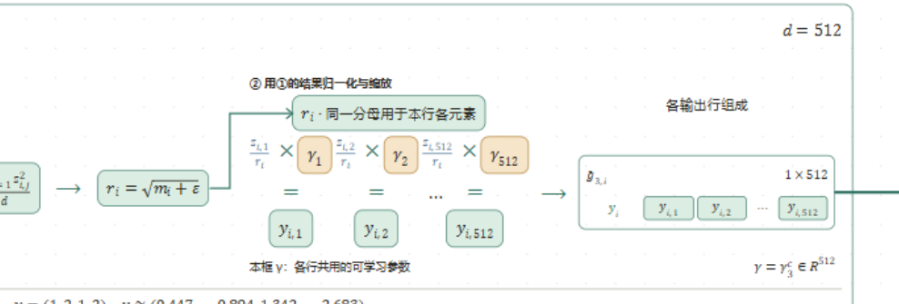

| 编号 | 反面模式 | 改法 |
| --- | --- | --- |
| 06.a | 平方、指数、加 ε、开方各配装饰箭头 | 直接写平方项、正常数学幂或紧凑定义；箭头只承担数据去向 |
| 06.b | 指数用 exp 标签，把整个指数/分式套数据框 | 使用 e 的幂；仅输入变量可用元素小框，底数与分式保持数学排版 |
| 06.c | 向量除共享标量拆成许多支路再合并 | 画整行分式，再接逐元素缩放参数与展开的输出行 |
| 06.d | 为“紧凑”把真正的归约、参数、旁路也删掉 | 保留 RMSNorm 跨元素求和、Softmax 共享分母、Attention 加权汇合 |

**检查：** 查可见 exp/装饰箭头、指数小框边界及真实汇合数量；人工区分“解释同一次计算”与“又算了一次”。相关测试：`e2e/compact-normalization.spec.ts`、`e2e/compressor-structure.spec.ts`、`tests/deepseekRmsNorm.test.ts`。规则见[简单计算的展开边界](structure-semantics.md#简单计算的展开边界)。

## 07 · 没有整页横向滚动，不代表没溢出

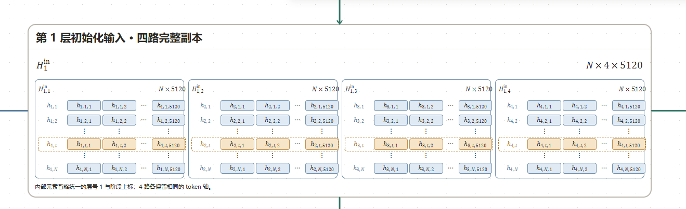

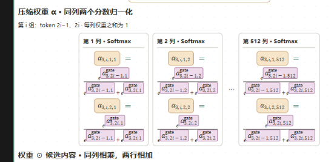

| 编号 | 反面模式 | 改法 |
| --- | --- | --- |
| 07.a | 只检查外层 scrollWidth，漏掉子矩阵越框 | 逐级比较标题、末列、高亮轮廓与实际父边界 |
| 07.b | 长下标或分母换行，标题仍沿用固定高度 | 测渲染后的公式与标题，按内容扩展或重排 |
| 07.c | 等号在上行末，结果或分式被迫单独换行 | 按完整等式分配横向空间，必要时在语义边界分行 |
| 07.d | 省略号贴顶部、只画一个竖点串、或挤入元素格 | 点串沿被省略轴居中；纵向省略继承各数据列轨道 |
| 07.e | TeX 无解析错误，却出现裸 times/operatorname | 同时扫描可见文字和数学渲染错误，检查 JSX 转义语境 |

**检查：** scroll 尺寸、实际矩形包含、普通/高亮格尺寸、最长下标、窄屏及保存旧尺寸；再看截图是否可读。相关测试：`e2e/residual-containment.spec.ts`、`e2e/matrix-grid.spec.ts`、`e2e/compressor-structure.spec.ts`、`tests/mathMarkup.test.tsx`。不能用裁切或缩字把数值检查“修绿”。

## 08 · 符号变了，但读者不知道发生了什么

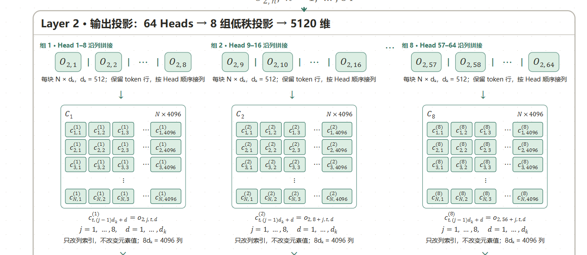

看 O→C：公式映射虽然存在，图形中仍缺少“这段列就是原来的某个 O”的直观对应。

| 编号 | 反面模式 | 改法 |
| --- | --- | --- |
| 08.a | k3t 连写、层号/token/特征下标无定义 | 用正式上下标，首次出现交代每个索引含义；不假定读者会自行拆开 |
| 08.b | 小写 u 突然变大写 U，把一行与矩阵混用 | 向量、标量、矩阵按类型命名，直接画“多行组成矩阵” |
| 08.c | O→C 或分组 B→B 同时拼接改名，看不出来源 | 先保留原符号拼接，或在结果中圈出原块、列区间及映射 |
| 08.d | 局部简写没有有效范围，跨模块仍沿用省略名 | 简写前定义固定索引和分量映射，出口恢复完整符号 |
| 08.e | 形状写对了，实际框把单列参数当整个矩阵 | 同时核对对象粒度和乘法：整行输出对应完整参数矩阵，单列只得一个标量 |

拼接不改变数值，不暗含求和或投影。token 轴与特征轴分别标明；当前行不能与完整 N 行矩阵用等号硬连。G 的复用别名另见第12类。

**检查：** 对映射、形状、首/次/末代表块做单测；浏览器核对圈定区域与来源索引。相关测试：`tests/headGroupConcat.test.tsx`、`tests/diagramNotation.test.tsx`、`e2e/concat-and-route-regression.spec.ts`。规则见[拼接保留来源与索引](structure-semantics.md#拼接保留来源与索引)。

## 09 · 颜色数量少是表象，角色映射不稳定才是根因

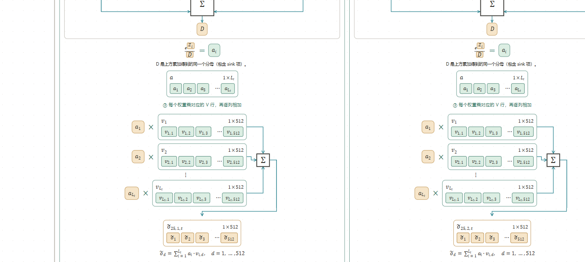

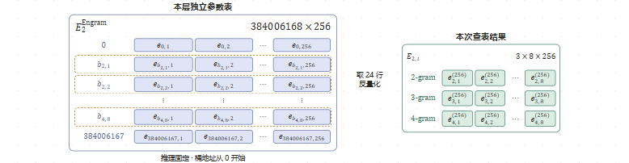

| 编号 | 反面模式 | 改法 |
| --- | --- | --- |
| 09.a | 同一变量从生成到消费无理由换色 | 按对象追踪生成、代理、别名、消费，统一色系 |
| 09.b | 参数、概率、分数、分母、激活都挤在少数颜色里；色板增加但图没用 | 至少20个实际使用的语义色系，先定义角色；实测真实元素填充，不能把边框/底色重复计数 |
| 09.c | 已选行只加虚线、虚线紧贴元素，或高亮底色与元素边框异色 | 被选元素用同色加深或琥珀填充，边框配套同色系；保留行号和来源标签，虚线四周留净空；普通与选中格尺寸一致 |
| 09.d | 鼠标选中与数学取行高亮混在一起 | 交互强调原边框；语义选择表达真实被取数据，两套状态分开 |
| 09.e | 为透明风格抹掉全部子元素底色，或让线穿字 | 容器透明、真实元素有填色；边线层级和文字净空仍需检查 |
| 09.f | 来源色与状态色未分清，读者无法追踪 G 与 U | 常态 U 绿、G 海蓝；选中可同色加深或琥珀，同组选区一致并保留来源；追加以分隔线标记 |
| 09.g | 改了单行结果的颜色，按原行序组成的完整矩阵仍使用旧色 | 单行与批量输出共用角色参数；同时测试 Prefill/Decode，不能只看一种模式 |

不要求每个模块用满20色。变量名、形状、行号和端口仍须独立说明关系，不能只能靠色相辨认。纯拼接保留来源色；生成与消费处同时更新，不为凑色将同一对象改成两个身份。

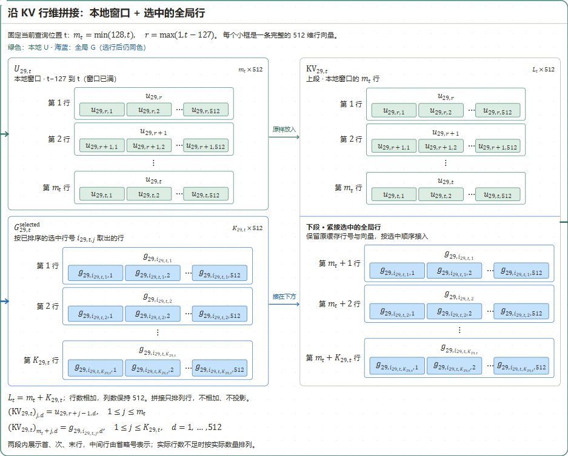

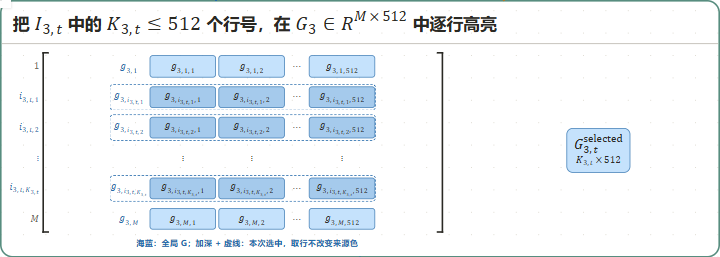

这两张图只展示身份色与选中状态的修正，不作为全页布局、连线或虚线净空全部通过的证明。同色加深与琥珀高亮均允许，两者可以并存；但元素填充与自身边框必须同色系，外围虚线另留可见间距。琥珀底配蓝边、虚线紧贴元素都属于反例，不能用“保留来源”作为理由。

**检查：** computedStyle 沿同变量链比较，选中与未选元素填充比较，尺寸对齐与原边框数量检查；人工看正常阅读尺度的对比。相关测试：`e2e/compact-semantic-regression.spec.ts`、`e2e/compressor-structure.spec.ts`、`e2e/white-tensor-surface.spec.ts`、`tests/mhcColors.test.tsx`。角色表以[语义配色与透明层级](react-flow-layout.md#语义配色与透明层级)为准。

## 10 · 消费者在左，连线却从右边绕整圈

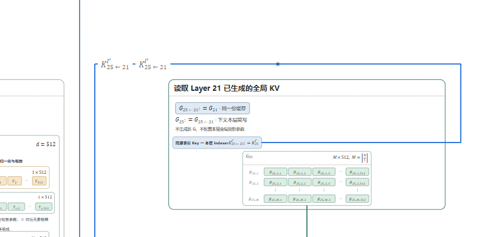

| 编号 | 反面模式 | 改法 |
| --- | --- | --- |
| 10.a | 所有输出固定右侧，忽略消费者方位 | 自动端口侧参与路由选择；合法前提下优先少转折，再短距离 |
| 10.b | 线从空白包装层起画，或只接大分组中心 | 取真实变量/向量/矩阵的边界；源端与目标端都测间隙 |
| 10.c | 只测没有穿框，漏掉折返尾刺、共线重叠、箭翼拥挤 | 按完整真实路径检查各线段、端口法向、净空及箭头 |
| 10.d | Σ 多输入挤同一点，或只有最后一项真正接线 | 给每个展示输入独立边缘落点，输出单独留通道 |
| 10.e | 标签只避自己的线；长线入口仍不知道变量是谁 | 标签参与全局避让，入口复述同一完整变量，改字与拖动后重查 |

**检查：** 真实 SVG 子路径、边数量、handle、两端间隙、折点与标签矩形；人工看箭头方向和来源可追踪性。不要跨标签断口虚构一段“穿字线”。相关测试：`e2e/full-route-audit.spec.ts`、`e2e/sum-source-attachment.spec.ts`、`e2e/edge-label-audit.spec.ts`、`e2e/edge-arrow-clearance.spec.ts`。保存过的人工路径不能被自动短路策略擅自覆盖。

## 11 · 本层历时缓存与层间传递混成一件事

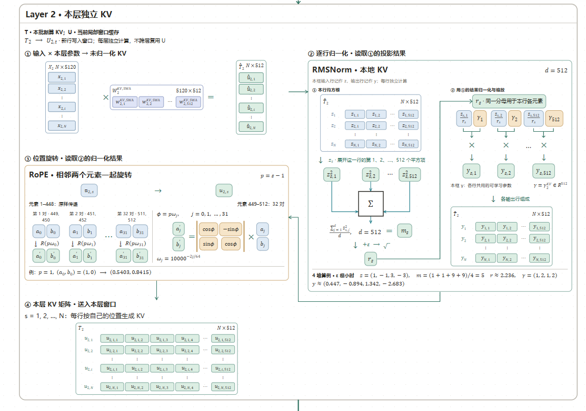

这张图证明的是“读者看到的这段链没有接到窗口与 Attention”，**不能据此断言当时全页完全没有窗口**。用户随后的困惑是：下一层是否还要拼上一层的 KV？

| 编号 | 讨论风险／表现 | 必须让图回答的问题 |
| --- | --- | --- |
| 11.a | 把层间隐藏状态传递理解成跨层拼本地 KV | 本层输入从上一层输出而来；本层新 KV 由自己的参数算出，追加自己的历史 |
| 11.b | 把 W 上的 SWA 分支标签当成滑动窗口算子 | 参数投影与窗口更新是两段；参数负责生成新行，窗口决定读哪些行 |
| 11.c | 当前 t 加前128行，误成129行窗口 | 满窗旧 t−128…t−1 共128行；退出 t−128，保留127行，再加 t，总数仍128 |
| 11.d | u、逐 token 的逻辑结果、实际持久窗口统称 U | 为不同对象分配不同符号；定义单行、逻辑集合、当前存储和当前读取范围 |
| 11.e | 只画生成或只画窗口，当前 Q 不知道读哪里 | 连成“新 KV + 旧窗口 → 更新窗口 → 当前 Q 的打分和 V 加权” |

逐层主图用一般 t；129/130仅用于用户指定的数值演示，并贯穿整条链。灰色淘汰行位于有效窗口括号外，不能接到本步 Attention。缓存位于哪种存储设备是实现问题，不应把“缓存”直接等同于 CPU 内存。

**检查：** 用可执行数据验证旧行、保留行、新行、行数与 token 映射，再检查追加落线和消费对象。相关测试：`tests/perLayerCache.test.tsx`、`tests/cacheDecode.test.tsx`、`e2e/layer-two-swa.spec.ts`、`e2e/layer-cache-inline.spec.ts`。本项目128窗口约定不是所有模型的通则。

## 12 · “复用”只剩两个字，来源、时间和范围都丢了

本类参照[独立共享大块反例](#case-04)。主要问题来自整段对话的概念追问，不能用截图替代模型事实核对。下列是当前 V4.1 图需要避免的误读，不外推到任意 CSA 或 Transformer。

| 编号 | 讨论风险 | 图中要分开的对象与动作 |
| --- | --- | --- |
| 12.a | Full 被理解为每步重算全部历史 | 本步新算与历史直接读分开，Full 也保留自己的历史缓存 |
| 12.b | Reuse 被理解为本层完全不算了 | 本层输入、主 Query、本地 KV/SWA、Attention 和 FFN 仍沿实际路径显示 |
| 12.c | 全局缓存被理解成所有层唯一的一份，或每层必有独立 G | 显示真实 Full 来源与共享范围；前两层纯 SWA 不冒充 G |
| 12.d | G、索引 Key、分数 S、最终 ID 都笼统叫 Indexer 缓存 | Full 生成 G/Key 并选行；Reindex 读来源 G/Key、自己打分选 ID；Reuse 读共享 G 和同 token 的 ID |
| 12.e | 用 G25=G21 后看起来第25层新算了一份 G | 首次写来源别名 G25←21 := G21，交代同对象引用；定义后才用本层简写 |
| 12.f | 只画第3、4层，漏掉后续共享范围 | 每层标 G 来源和 ID 来源；G21 的范围与25/29/33/37重新选 ID 的分段分别表达 |
| 12.g | SWA 每步淘汰被误套到 G；未凑满压缩组也追加 | 按配置画暂存、组满压缩与 G 追加；旧 G 直接读，窗口淘汰不删 G |
| 12.h | 到下一个 Full 就以为此前 Full 的历史被销毁 | 后层改变共享来源，不等于前一 Full 的持久历史消失；下一 token 各来源层仍按其规则使用自身历史 |

“不用的权重是否还存在”要核对实际参数化与实现，不能由“复用”二字推出所有系统都会删权重。把复用当成本层原结果的替代是讲解方法，不是凭空画出实际不存在的 G 生成参数。

**检查：** 配置层表、模式参数存在性、G/Key/ID 来源和当前 t；图上核对源端、别名、读取线与 Attention 拼接。相关测试：`tests/cacheSemantics.test.tsx`、`tests/perLayerCache.test.tsx`、`e2e/cache-semantics.spec.ts`、`e2e/indexer-origins.spec.ts`。具体压缩规则以模型来源与[窗口结构契约](structure-semantics.md#选择切片与窗口必须展开高亮)为准。

## 13 · Indexer 有公式，却看不见它究竟选谁

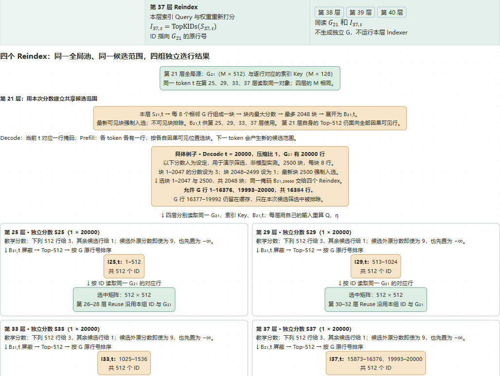

这里只判定解释方式过密；截图中的教学数值不能当成模型真实测量。

| 编号 | 讨论风险／反面模式 | 改法 |
| --- | --- | --- |
| 13.a | 以为从本层 Query 矩阵里选行 | Query 提出本次查询，候选对象是 G 的行；索引 Key 与 G 行对应 |
| 13.b | 候选掩码、原始分数、最终 TopK 行号混为同一对象 | 按实际流程分别命名、展形状、连来源，标明谁过滤谁 |
| 13.c | ID 没有回到 G 的原行号，看不出选了什么 | 从分数到 ID，再到 G 中高亮对应行，最后接本层窗口拼接 |
| 13.d | 多个 Reindex 读同一 G，就误认为同一分数和 ID | 同 token 的共同来源与各层独立 Query/权重分别画；相同 M 不代表相同结果 |
| 13.e | 例子候选行不超过512，Top512全部入选却用于演示筛选 | 演示最终筛选时选择超过预算的池；演示块预筛还须超过其块预算，数值由同一数据源生成 |
| 13.f | 被过滤行看起来从缓存被删除，或 TopK 排序与位置排序混淆 | 区分本次可选范围与持久存储；分数排名、位置顺序、原行号分别表示 |

同一 G 上的 Key、S、ID 是不同类型，不可混画。候选范围对当前 t 生效，下一 token 不应无条件沿用上一 token 的 ID。完整 S 的行是查询 token，列是被评分的缓存行；当前行分数不能冒充全序列共享矩阵。

**检查：** 对掩码、得分排序、TopK边界、原ID映射、取行结果写数据单测；浏览器检查源池、高亮、形状、消费者。相关测试：`tests/reindexCandidates.test.tsx`、`tests/cacheDecode.test.tsx`、`e2e/indexer-origins.spec.ts`、`e2e/candidate-score-caption.spec.ts`。不能只断言文字里含“TopK”。

## 14 · Engram 用抽象收益和箭头标签掩盖了实际计算

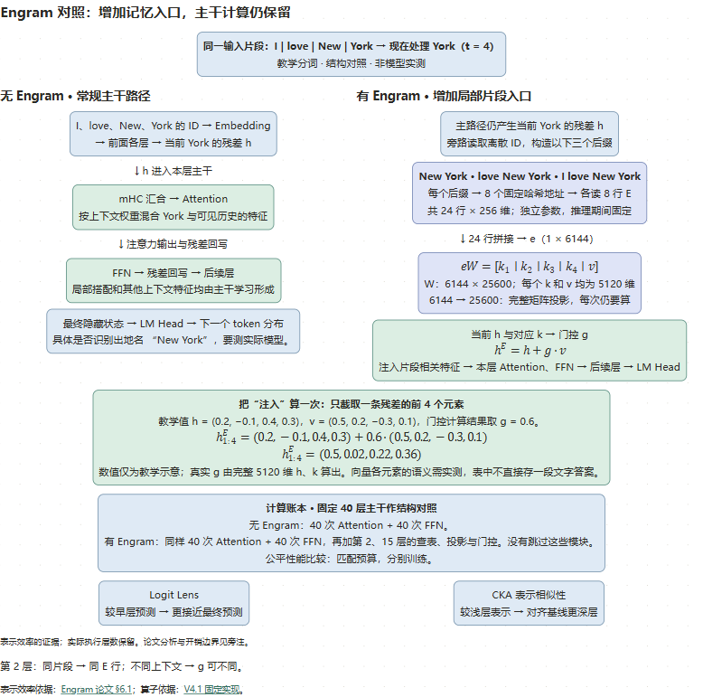

反量化遗漏参照[Engram 竖排图](#case-03)：那里“取24行、反量化”只有箭头标签。排版与计算缺失是两件事，横排本身不能补回数学过程。

| 编号 | 讨论风险／反面模式 | 改法 |
| --- | --- | --- |
| 14.a | “减轻主干负担”被理解为当前图跳过 Attention/FFN | 显示实际仍执行的主干和新增查表/投影/门控；不虚构被跳过的层 |
| 14.b | 声称省计算，但没有相同预算或能力目标下的比较 | 旁注交代论文或实现的比较口径；固定主干额外加入模块不能直接宣称每 token FLOPs 下降 |
| 14.c | 只有“取24行反量化”，没有尺度、运算和输出类型 | 按实现展示量化存储、同地址尺度、类型转换、乘尺度与结果；不能把数据类型当算子 |
| 14.d | 哈希地址被看成注意力权重或语义相似度检索 | 区分 token ID、地址计算、参数表行号、读出向量与下游门控 |
| 14.e | 单独举 token 片段，没接回真实层输入和输出 | 示例对应本层真实查表入口及注入点；示意值标明，不伪装成模型实测 |
| 14.f | token、哈希公式、地址向量散放在空框里，只有一根悬空箭头 | 每项 ID × 乘数接入按位异或，同一结果分到各头取模与加偏移；按实际内容收紧三个分支 |
| 14.g | 算出 24 个行号后只写“同号读取”，或从整表外框接到一套悬空的反量化操作数 | 三组地址保留原符号拼接；每个展开行号连接两表同名行。代表行写明 b 的别名，从真实选中行接到展开的数值、系数行；各系数元素连向对应 32 列块，结果接回该地址的输出位置 |

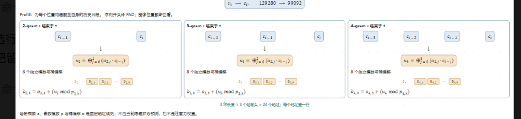

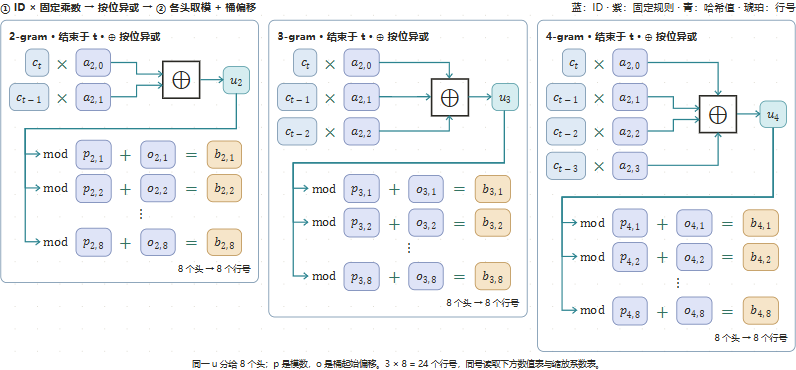

哈希分支检查复用 `tests/engramHash.test.tsx` 与 `e2e/engram-hash.spec.ts`：核对乘积数量、实际源/目标边界、穿框及溢出，在第 2、15 层的两种模式截图。单项算术保持紧凑表达；多输入汇合和跨头广播须真实接线。接线从实际内容边界起画，不能从撑宽的行容器引出一段悬空线。

`tests/engramAddresses.test.tsx` 与 `e2e/engram-addresses.spec.ts` 接着检查查表链：9 个代表行号对应 18 条选行线，两表使用同一来源；读出线来自同一具体行，每个已展示系数的源元素与目标操作数同名，列范围与块号对应，结果接回对应输出位置。实际端点贴合数据边界，穿字、穿框和溢出报错。覆盖两层、两模式及宽窄画布，仍需截图确认关系可读。

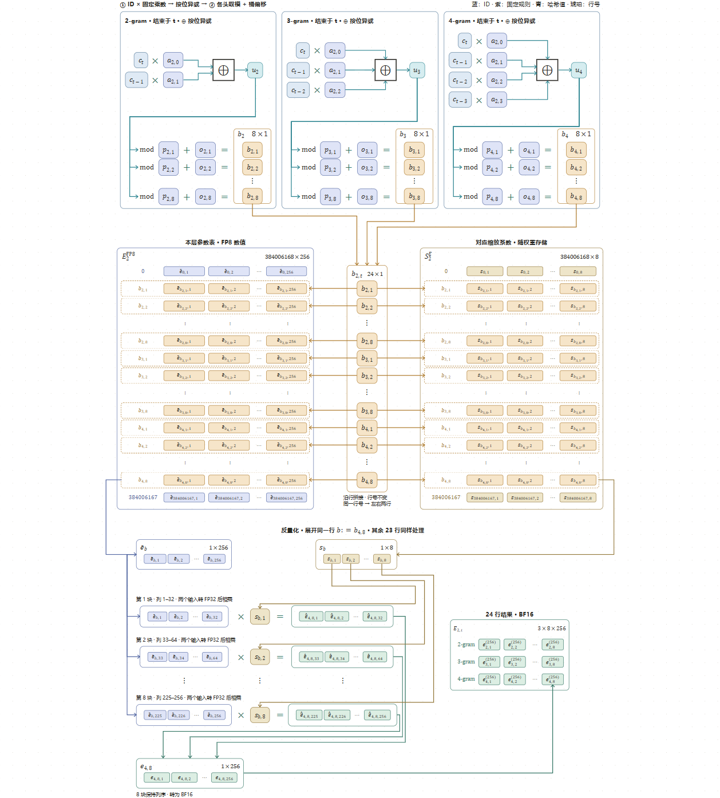

反量化并非对所有格式都只有“乘一个尺度”：是否有零点、分块尺度、转换顺序须核对来源。本项目具体过程由实现与测试定义；可用一个代表元素解释数学过程，再保留整行输出，不重复展开24条同构路径。

**检查：** 读取行号与尺度行号一致、转换和乘法存在、形状连贯、主干未被错误删减；收益结论必须人工回到实验设定。相关测试：`tests/engramPurpose.test.tsx`、`e2e/compressor-structure.spec.ts`、`e2e/engram-gate.spec.ts`。图中文字少，不等于可以漏计算。

## 15 · 只修截图实例，或把布局数据当完整图规格

本类来自用户“不是单个问题”“有没有可复用组件”“能否扔给另一个 AI 还原”的直接要求，无独立错误截图。

| 编号 | 反面模式 | 改法 |
| --- | --- | --- |
| 15.a | 只改第2层的硬编码块，其他层同类结构仍旧 | 找公共图元和手写变体，列调用范围；参数化差异，不复制整层 |
| 15.b | Full/Reindex/Reuse 复用相同外观，却丢失真实计算差异 | 公共的是表达语法，模式不同的参数、生成分支、来源不能抹平 |
| 15.c | 声称布局 JSON 或模型配置能独立还原完整内部图 | 明确当前数据缺少哪些内部结构；源码、锁文件、模型/层/模式与人工布局共同交付 |
| 15.d | SVG 当成通用可编辑语义图，或只导出当前视口 | 说明 SVG 是外观快照及 foreignObject 边界；验证屏幕外内部节点、字体、离线打开与相机不变 |

**检查：** 检索所有调用方，覆盖模式分支与代表层；导出做真实下载、解析、离线截图和错误恢复。相关测试：`tests/architectureBoundary.test.ts`、`e2e/cache-svg.spec.ts`。当前能力边界以仓库 `docs/architecture.md` 为准，不在反例库承诺尚未实现的统一语义 JSON。

## 16 · 检查通过，但证据没有回答用户的问题

已知本轮之前的局部验收经历：分数框的 DOM 断言通过，第一次截图却截到了错误区域；人工打开图片后才发现并重新定位截取。这证明“生成了 PNG”不是视觉验收。它不是上面原始用户附件的错误内容。

| 编号 | 反面模式 | 改法 |
| --- | --- | --- |
| 16.a | 图片文件存在就说截图检查完成 | 打开图片核对目标模块、层号、完整边界与可读尺度 |
| 16.b | 单测、几何脚本通过就说整图没问题 | 分别报告语义、DOM/几何、人工截图和交互证据，注明覆盖范围 |
| 16.c | 只截局部，漏掉模块空旷；只截全图，字小看不见溢出 | 同模块提供全貌与可读细节，必要时加入口/出口局部 |
| 16.d | 只检查第3层或一个宽屏，声称修完所有层 | 按模式分支、最长标签、复杂层、纯SWA层、复用层和窄屏取代表样本 |
| 16.e | 为通过审查放宽距离、隐藏标签、调到宽度阈值以下 | 修布局或测试误判根因，保留能暴露原问题的断言 |

**检查：** 每组证据记录 URL、版本、模型、层号、Prefill/Decode、viewport、缩放、模块 ID、是否加载人工布局、实际执行项。脚本与人工结果分栏记录；“未运行”不是“通过”。详见[检查方法与覆盖边界](inspection-playbook.md)。

## 17 · 静态截图合格，不代表可以拖动和继续编辑

本类对应用户30ms目标及已有交互契约；以下是回归风险，不是声称每项都在用户截图里发生过。

| 编号 | 反面模式 | 改法 |
| --- | --- | --- |
| 17.a | 只测处理函数耗时或一次拖框，声称所有交互30ms内 | 分别实测平移、滚轮、缩放、拖框、拖线；区分事件、DOM与下一帧反馈 |
| 17.b | 静态路径正确，拖动后端口停在旧坐标或出现斜段 | 连续真鼠标操作后检查实际路径、端口法向、正交性和源目标间隙 |
| 17.c | 撤销、重做、保存恢复只检查按钮可点 | 检查节点、边、标签的真实几何恢复，一次手势一条历史 |
| 17.d | 内部小框看起来可选，实际只选父框；面板遮住对象 | 点击最内层对象，核对选中身份、解释内容与面板开关序列 |

**检查：** 生产构建中独立运行性能组，记录首次、P95、最大值、帧间隔、输入和有效样本数；不得把 DOM 后下一 rAF 等同显示器呈现。相关测试：`e2e/interaction-budget.spec.ts`、`e2e/wire-drag-topology.spec.ts`、`e2e/editing-regression.spec.ts`、`e2e/internal-selection.spec.ts`、`e2e/module-inspector.spec.ts`。性能与结构正确性都要保留，不能二选一。

## 18 · 改的是另一入口，或者擅自发布

本类来自用户反复确认本地地址和“听命令再部署”，不是视觉风格问题。

| 编号 | 反面模式 | 改法 |
| --- | --- | --- |
| 18.a | 只改独立章节，用户打开逐层页仍看旧内容 | 在指定 `chapter=layer` 和层模式直接验收；不拿另一页截图代替 |
| 18.b | 本地、旧线上链接、构建版本混着汇报 | 说明本次修改位置、预览入口与是否发布；旧链接不是自动更新证明 |
| 18.c | 每次修图都自动部署，忽略用户后来收紧范围 | 默认只改本地；只有新的明确发布命令才部署，不沿用早期授权 |
| 18.d | 用户只要求总结 skill，顺手重构图或处理无关缺陷 | 本轮整理文档和图片证据，不改应用、账户或部署；新发现仅如实区分范围 |

**检查：** 交付前对照请求、git diff 路径、实际测试 URL 和外部动作记录。技能中的修复义务不能扩张本轮任务授权。

## 如何继续增加案例

先判断是否属于已有类别，优先补同类模式而不是复制整段规则。新案例包含：用户原话的短摘要、实际图及准确位置、误读风险、改法、自动检查与人工边界。图片缺失就标明缺失，不能生成一张“原始截图”。模型语义结论另核对原始资料，不能凭用户猜测定稿。

新增图片同步登记来源清单；正例明确比较范围。维护后运行本 skill 的 `scripts/validate_casebook.mjs` 检查图片、引用和编号，再实际预览文档。资产检查只证明案例库可用，不证明架构图正确。
