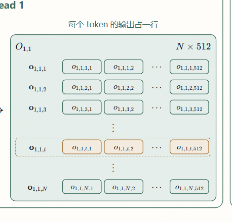

# 结构语义契约

## 图形语法

| 对象 | 表达方式 | 端口规则 |
|---|---|---|
| 矩阵/张量 | 外层数据框，标题含符号与维度 | 端口属于真实发生数据流的边界 |
| 行/列向量、head 切片 | 矩阵内部的独立小框 | 每个已展示切片都可有独立端口 |
| 元素、分数 | 向量内部的小单元格 | 被选择、路由或加权时可直接连线 |
| 参数矩阵 | 与数据框视觉有别，但仍是数据对象 | 连接到真正的运算节点 |
| 运算 | 无填色方形汇合节点、裸运算符或命名算子 | 操作数分别进入，结果从出口离开 |
| 分组容器 | 只提供背景、标题和对齐 | 不用容器中心端口冒充内部对象端口 |
| 省略号 | 表示未展开的同构分支 | 不接线、不参与计算 |

嵌套关系和数据流必须分开：小框位于大框内部只表示“属于”；只有边表示“流向”。

张量分解优先画结构，不写成一整行拼接公式。展示单个 token 的 Head 分块时，先在完整矩阵里高亮第 `t` 行，再用横向大框排列该行对应的 `\mathbf q_{l,1,t}`、`\mathbf q_{l,2,t}`、省略号和 `\mathbf q_{l,H,t}`。等号两侧必须是同一对象，不能把整个 `Q_l` 等同于第 `t` 行的分块。

行向量本身用横向小格表达其元素：首元素、次元素、省略号、末元素。矩阵由纵向排列的行向量组成；需要解释点积、逐元素加权、列选择或具体元素来源时展开元素。空间宽裕时也可用代表性元素格呈现索引规律，采用下方优秀案例的排布；窄处保留向量级结构。

大对象的代表项至少显示第 1 项、第 2 项和最后一项，省略号不算明确项。行、列、元素和重复分支均遵循此规则，以便读者看出哪个上标或下标在递增。即使另有高亮当前行，也不能省去第 2 行；对象本身只有两项时完整展示即可。

省略号放在实际被省略的轴上；省略完整分支时点串在所属分支区域中部，不贴标题或顶部。展示第 1、2、末项乘积时，第二项与末项之间必须有横向省略号；矩阵或三列广播省略中间行时，每个已展示的数据列各有一个对齐的纵向省略号，不能只在整行中间放一个。展示三列就并排三个竖省略号，展示四列就四个；行名栏与横向省略列留空，不能用固定数量代替实际列结构。注明代表项是特征、token 行还是 Head，不能让三个代表元素看成仅有三个 Head。

缩放优先写符号及定义，例如点积结果写成分式，分母为 `\sqrt{d_k}`，旁边定义 `d_k=512`；不用 `÷` 或斜杠替代正式分式。共享数据首次出现直接写等式，例如 `K=KV_{l,t}`、`V=KV_{l,t}`，同时说明二者分别用于打分和加权。

### 拼接保留来源与索引

拼接同时改名时，必须看得见原块如何占据结果：优先先画保留 O/o 等原符号的纯拼接矩形，圈出首、次、末来源块并标列区间，再明确命名为 C/c；也可直接在结果矩阵内圈出对应原块并标映射。只有 O→C 的一根线加映射公式不足以说明来源。此规则同样适用于行拼接、Head 合并及其他符号切换；代表块内大小一致，省略号沿实际省略轴放置。

拼接先显示原始块，再显示拼接结果；块间用 `\mid` 分隔，标明拼接轴和顺序。重复块保留首、次、末项及明确省略号，不为讲清拼接而把八个 B 全铺开；容器随内容一起收紧。V4.1 的 O→C 说明每组包含八个 Head、token 行不变，`c^{(g)}_{t,(j-1)d_k+d}=o_{l,8(g-1)+j,t,d}`。B₁、B₂、…、B₈ 的内部元素保留各自的 `b^{(g)}`；下方结果仍保留组上标，并写明 `B_{t,(g-1)r+j}=b^{(g)}_{t,j}`、`r=1024`。拼接只改变位置和索引，不隐含相加、投影或数值变换。验收同时检查每格自身溢出与整排内容相对父框的边界，避免内部尺寸正常却被祖先容器裁切。

分组输出投影中，每组计算 B 按 `C × W = B` 横排，不将三个矩阵和运算符堆成长柱；保留既有 O→C 与 B 沿列拼接的结构。按完整运算行所需宽度分配组间空间，检查相邻组不相撞，最终投影也按内容收紧。

可学习参数必须在图内交代来源，旁注不能代替来源框。mHC 的 s、b 显示为本层、本子层独立的 3 元缩放参数与 24 元偏置参数，说明训练学习、推理加载、所有 token 共享；标出 s₁/s₂/s₃ 与 b 的三个区段分别供 p/q/C 使用，且在简写前定义完整符号映射。不得让参数看起来是 u 新生成的结果。V4.1 对应官方 `hc_attn_scale/base` 与 `hc_ffn_scale/base`。

一个区块已经用文字说明重复步骤时，不再在短句之间和两侧重复堆装饰箭头。Sinkhorn 的后续轮次保留起始矩阵、重复次数、行列归一化规则及最终矩阵即可；真正的数据连线与方向仍保留。除法统一用正式分式，整页检查可见 `÷` 与公式 `\div`，包括 mHC、RMSNorm、Softmax 和旁注。

变量名、维度和内部元素属于同一个数据框；职责、来源、参数身份、历史保留、追加条件等描述性文字一律在数据框外紧邻标注，长解释进入旁注。例如“本层分数”放在 S 框外，S 与形状留在框内；数据框不能被相邻较高的说明区拉伸。不得为了包住说明而再给已有数据框套一层外框。分支分组框仍可有简短阶段标题，但不能冒充数据对象。一个矩阵由行向量组成时，用横条纵排；由列向量组成时，用竖条横排。外框按实际内容收紧，维度用标注表达，不靠空白撑大。允许“变量 =”后换行展开结构；短等式能同排时优先将操作数、等号与结果对齐，不把等号留在上一行末尾。

投影尽量按“输入 × 权重 = 输出”在同一排完成，矩阵符号与形状写在各自框内，不在外侧重复 `=Q=`。升维后的完整矩阵必须保留大写 `\widetilde Q_l`，再高亮其中第 `t` 行；该行的小写粗体向量由横向 Head 分块组成。整个矩阵与单行向量不能直接用等号连接。

矩阵乘法使用“代表行 × 代表列 = 输出元素/输出行”的结构语法：

- 输入矩阵展示一条带行号的代表行向量；
- 参数矩阵展示若干带列号的代表列向量；
- 输出行横向展示对应元素，每个元素明确来自同一输入行与相应参数列的点积；
- 大矩阵只保留首、次、省略号和末项，不为完整展开而完整展开。

这里的等号和乘号是裸运算符，不能套成与数据矩阵相同的框。

严格核对投影粒度：`x（1×d） × W（d×k） = y（1×k）`，而 `x（1×d） × w_j（d×1） = y_j（标量）`。完整输出行必须对应完整权重矩阵，矩阵内至少保留首、次、末代表列及省略号；不能用一个列向量框冒充整个 W。单列对应单个输出元素，列切片映射与重复的标量推导放旁注；主图已有整行投影结构时不再堆三条同构等式与长解释。回归检查操作数形状与结果粒度，不只检查矩阵名是否出现。

### 加权汇合与输出命名

对同一 token 的多路完整向量做加权汇合时，优先在同一排展示 `p（1×k） × H_t（k×d） = z_t（1×d）`。权重行展开各路系数，路矩阵每行对应一条完整向量，输出行展开代表元素；必要时在下方用一个输出元素的点积解释列对应关系。各 token 的输出行组成 `Z（N×d）`，随后再进入归一化与子层。不同 token 使用各自的权重，不能把这一局部矩阵乘法误写为同一权重行乘全序列张量。

Indexer 的 Head 加权同样先画 `η_t（1×H） × A_t（H×M） = s_t（1×M）`，A 的行来自各 Head 未加权的分数行，列对应候选缓存行。首次组矩阵时定义元素映射，不能把已乘 η 的结果再次放进 A。下方代表列的乘积、Σ 和公式明确标注为同一次矩阵乘法的展开，不画成额外串行运算。不同查询 token 对应不同 A_t；完整 S 由逐 token 的结果行组成，不能误写成全序列权重矩阵乘一份共享 A。

输入的多路状态、汇合后单路结果和归一化结果分别命名，并在连线、数据框、内部元素与旁注中同步。当前 V4.1 图使用 `H_l^{in}` 的四路状态、Attention 汇合结果 `Z_l^A` 和归一化结果 `X_l`；FFN 对应 `Z_l^F` 与 `Y_l`。权重来源与初始值按模型事实说明，不能把示例里的等权向量当成模型固定权重。

**错误案例：** 四份 `p_c h_c` 分散成四个长分支再接 Σ，权重与路索引的对应关系难读；更严重的是把汇合后的 `N×d` 结果继续标成输入的 `N×k×d` 状态。应保留完整维度和索引，使用紧凑矩阵乘法结构，并给变换后的对象独立名称。只有需要解释各项实际分流或异构路径时才单独展开分支。

## 优秀案例：行向量组成的矩阵

用户确认的参考图：Head 输出矩阵 `O_{1,1}`，每个 token 的输出占一行。



- 矩阵符号放左上角，`N\times512` 放右上角，维度作为小标注与符号同排。
- 行向量名在左侧对齐；右侧用横向小元素格代替一整条实心向量框。普通行不再另套一层行框。
- 行按第 1、2、3 行、省略号、第 `t` 行、省略号、第 `N` 行纵排；元素按第 1、2 列、省略号、第 512 列横排。空间宽裕可再展示第 3、4 列，保持索引连续。
- 行名使用粗体小写向量，元素使用普通小写标量，所有层号、Head 号、token 行号和元素列号完整保留。例如 `\mathbf o_{l,h,t}` 对应元素 `o_{l,h,t,1}`、`o_{l,h,t,2}`、省略号、`o_{l,h,t,512}`。
- 高亮第 `t` 行时，该行已展示的元素格一起换成琥珀色；可用一条细虚线包住行名、元素格和省略号，表示整行选中。其余行沿用矩阵色系。
- 同列元素格对齐，省略号保留独立空位。框按内容收紧；长下标先调整空间分配，检查元素格内部裁切，保留可读字号。

在 `U`、`G`、`Y`、`O` 等行向量组成的矩阵中按实际空间复用此排布。模型维度和语义随对象改变，案例中的 `512` 与配色不作为所有矩阵的固定值。参数矩阵的列向量仍用竖向小框表示。

## 选择、切片与窗口：必须展开高亮

选择是视觉结构，不是代码演示。以下写法不能单独作为图中结果：

```text
G[I, :]
X[r:t, :]
window(128)
gather(matrix, indices)
```

无论实现代码是否这样写，图中都必须同时具备：

1. 展开的源矩阵采用与运算匹配的粒度：取行时每个内部框代表一整条行向量，括号外标行号；只有取列或取元素时才展开列并在顶部标列号。
2. 独立的选择依据，例如窗口起点与终点、Top-K 行号向量或布尔掩码。
3. 在源矩阵上直接高亮被选中的完整行向量框、完整列、连续窗口或元素。不能只给选择结果换颜色，也不能在只涉及行向量时无意义拆成元素格。
4. 独立的输出矩阵框，写清输出行数、列数和每一行的语义。
5. 源矩阵过大时，可以展示普通首行、至少两个被选行、被选区中的省略号、最后一个被选行和普通末行；省略号不参与连接。
6. 若原矩阵已经直接高亮选中行，输出只需命名与标形状，不再复制一个内容相同的“选中子矩阵”。只有发生重排、拼接或维度变化时才另画结果框。

Top-K 取行应让读者看见 `I_{l,t}=(i_{l,t,1},i_{l,t,2},\ldots,i_{l,t,K_{l,t}})` 与源矩阵外侧行号对应，高亮 `i_{l,t,1}`、`i_{l,t,2}`、`i_{l,t,K_{l,t}}` 所在的整行。最终结果可命名为 `G_{l,t}^{\mathrm{selected}}`，不要继续用代码式的 `G_l[I_{l,t},:]` 充当结构。

矩阵首次出现时必须直接画出组成结构：`G_l` 大框内放 `\mathbf g_{l,1}`、`\mathbf g_{l,2}`、省略号和 `\mathbf g_{l,M}` 行向量框；`U_l` 同理。不能再用 `G_l=[\mathbf g_{l,1};\ldots]` 或 `U_l=[\mathbf u_{l,1};\ldots]` 这样的组成公式替代嵌套结构。

连续滑窗同理：先画完整矩阵，再高亮从 `r=\max(1,t-w+1)` 到 `t` 的连续行，并明确所有列均保留。`t` 是当前 query/token 的序列位置，`r` 是由 `t` 和窗口宽度算出的起点，不能让字母无定义地出现。

Decode 的滑窗更新必须接在本层真实 KV 生成出口上：本层输入乘本层参数，经规定处理得到当前新行；旧窗口作为独立历史输入，展示最旧行变灰退出、其余行原样保留、新行追加，再把更新后的窗口接到当前 Query 的 Attention。参数名中的 `SWA` 只标识本地 KV 分支，不能把参数投影画成滑窗操作。层间传递隐藏状态，不拼接上一层的本地 KV。

逐层主图统一用当前 token t，贯通投影、Query、连线标签、缓存结果和 Attention。窗口已满时，旧窗口 t−128…t−1 共 128 行；t−128 变灰退出，保留 t−127…t−1 的 127 条历史，追加本层新行 t 后仍为 128 行。一般起点 r=max(1,t−127)，窗口第 j 行对应 token r+j−1；当前 Q 对这些 K 行打分，再加权同批 V 行。追加线实际落到新行，灰行位于有效括号外，禁用环形槽位替代逻辑行序。仅在用户指定的算例中采用具体编号，且须贯通整条路径。

这一结构覆盖所有层，嵌入既有本层模块，不新增独立的大块说明。SWA 每步更新，与全局 G 分组追加分开：比例 2 的 Full 在 t=2i−1 暂存候选内容与 gate，t=2i 读暂存并结合当前新算结果，才生成第 i 条 G 和索引 Key；比例 1 每步追加。Full 保留自己的历史，Reindex 读来源 G/Key 并自行打分，Reuse 连同一 token 的行号一起读。Indexer 的对象是 G 行；取行后与本层 U 拼接，再供本层 Q 做 Attention。图与旁注同时标明本步新算、历史直接读、追加及复用来源。

## 变量、参数与阶段命名

对象来源不能只写“训练得到”。区分：① 独立参数，直接存储和优化，标明所属层、共享范围；② 参数派生量，由哪些已有参数经什么运算得到，画出依赖；③ 参数切片、转置或共享引用，明确原对象，不暗示增加独立参数；④ 输入相关的运行时结果，标明输入与运算，不能统称为训练参数。独立参数指参数化关系独立，不表示统计独立或分开训练。没有实际参数派生关系时不虚构该分支。例如 Compressor 的 W^{KV,G} 与 W^{gate} 是两组独立参数，w_j 是相应 W 的列，候选 KV、gate 分数与压缩缓存则是计算结果。

局部简写必须先定义再使用：写明固定的层号、token、专家或子层，以及完整符号到简写的对应式。例如 `o_d := o_{l,t,d}` 表示同一向量的第 d 个元素，`p_j := p^F_{l,t,j} = (\mathbf p^F_{l,t})_j` 表示权重向量的第 j 个分量。取行、重排、拼接、赋值和真正生成新值分别说明，不能用一次无说明的符号切换承担这些含义。局部映射的范围止于所在分组；模块出口和跨层交接使用完整符号。

**错误案例：** 上方是 `o_{1,t,1}`，下一排突然变成 `o_1`；或 `\mathbf p^F_{1,t}` 后直接出现 `p_1,p_2,…`，只在末尾写“省略层号”。应在简写前给出一一映射、固定索引和分量索引；已有数值例子也应说明它使用哪一行、哪一个分量。

- 同一个张量全图使用同一名称。第 `l` 层归一化输出写成 `X_l` 后，下游不能省略成 `X`。
- 大写字母用于矩阵/张量，小写粗体用于向量，普通小写用于标量。以 Query 为例：`Q_l\in\mathbb R^{N\times H\times d_h}` 是整层张量，`Q_{l,h}\in\mathbb R^{N\times d_h}` 是第 `h` 个 head 的矩阵，`\mathbf q_{l,h,t}\in\mathbb R^{d_h}` 是 token `t` 的行向量。
- 所有层内对象都带层号；同一张图切换到 Layer 3 时应出现 `Q_{3,1}`、`\mathbf q_{3,1,t}`、`O_{3,1}`、`Y_3`、`s_3`，不能继续显示每层都一样的 `Q_1`、`Y`、`s`。
- 新对象第一次出现时写清：它是标量、向量、矩阵还是张量；形状；由什么输入乘什么参数得到；送往哪里。
- token 视角必须交代 `Tokenizer → Embedding → 首层输入 → 完整投影矩阵 → 第 t 行 → Head 分块`。Prefill 的多行并行与 Decode 的当前一行分开呈现；t 是序列位置，不是无来源的随意选择。切换视角时连同形状、缓存含义和标签一起更新。
- 参数矩阵使用独立数据框并写出形状，例如 `W_l\in\mathbb R^{d_{in}\times d_{out}}`。旁边用短句说明“每个输入行从 `d_in` 维映射到 `d_out` 维”。
- 两个参数即使在代码中合并存储，若语义不同也应分开展示；反之，官方实现确实用一个共享潜向量投影时，不得凭习惯虚构独立 `W^K/W^V`。
- `Compressor`、`Indexer`、`Attention`、`MoE` 可以作为分组标题，不能作为黑箱内容。读者必须能在框内继续追踪输入、关键参数、运算和输出。
- 参数的来源与简称要解释清楚。例如图中使用 `W^{OA}`、`W^{OB}` 时，说明它们对应哪两个输出投影阶段、是否为可学习参数，并与官方符号对照；不能让读者误认成上游激活。不要为简化命名随意改掉层号或组号。
- “特征轴”必须落实到格子：同一 token 的各路向量横向拼接，标出每路对应的元素区间、边界与顺序；token 轴保持不变。不能只写“沿特征轴”或一个 Concat。
- “广播”必须落实到接收者：画出同一标量如何分别参与各元素乘法，或同一子层输出如何送往各目标路；旁注用“同一个值用于这些元素”等具体说明，不能只写术语。

## 算子内部展开

框内展示操作数、运算关系与结果；完整公式保留在大框外右侧作为对照，长推导放入解释面板。串行乘法直接用 `×` 与结果连接，不能只用“独立投影”代替运算符。标量乘向量时显式写 `\cdot` 或 `×`，避免 `q_jo` 被看成一个变量。数值例子的各项靠近排列，且与图中输入、输出符号一致。

- **SiLU**：输入 `z` 分为原值支路与 sigmoid 支路，后者用一个紧凑运算框写 `σ(z)=1/(1+e⁻ᶻ)`；两路带箭头进入乘法，输出明确命名 `a=z\cdot\sigma(z)`。矩阵层面保留对应的输入与输出矩阵，不能上方叫 `a`、示例或出口又换成匿名表达式。
- **RMSNorm**：从输入行直接展示代表平方项，分别连入无填色方形 Σ；随后除以实际元素数、加稳定项、开方。除法按整行画 `z/r`，有缩放参数则接 `⊙ γ`，直接得到展开的输出行；不把共享标量除法拆成多条支路再拼回。平方项直接标 `z₁²` 等，不重复画原元素、平方箭头和结果。γ 展开首、次、末元素并标明独立参数；无缩放参数不虚构。单行结果不能直接等同于多行矩阵；批量时另按原行序组成矩阵。输入、输出均展开，名称一致。
  宽区域内的均方根推导优先从左向右：输入矩阵、代表平方项汇入 Σ、均值、加 ε 开方，避免把短步骤堆成高柱。平方项可纵排并从不同侧接入 Σ，输出向右；保留首、次、末项及省略号。后续逐元素计算与输出矩阵可继续横排，让各分区高度接近；外框按内容收紧，不将一侧短流程撑成另一侧的高空栏。空间不足时分区整体换行，连接依据实测边界改向，不缩字、不裁切，也不强迫窄区域沿用整排。
- **RoPE**：标出位置索引来源、参与旋转与不旋转的维度；画成对元素、角度与 sin/cos、旋转矩阵乘法和结果对。只展示代表对并保留索引规律；输出旋转等模型特有步骤按官方实现核对，不能仅标四个字母。
- **Attention**：展开 Query 与代表 Key 行的点积、缩放得到分数；Softmax 展开指数、分母累加与除法；所得权重分别乘对应 Value 行，各乘积独立接入 Σ 后组成输出。掩码、sink 或额外分母项仅在模型实际存在时展示。省略的同构项单占一行显示省略号，不能写成挤在操作数旁的 `+ … +`，省略号也不接线。
- **mHC 系数生成**：从同一 token 的各路残差输入拼接得到向量，依次展开归一化、参数投影与系数分组。若使用 24 项分为 4/4/16 的模型，明确标出 `u` 的第 1–4、5–8、9–24 项，组间有边界；后 16 项要画出恢复 4×4 的对应关系，不能称作无来源的“其余”。各组缩放、偏置、中间量 `a` 到 `p/q/C` 的运算分别可追踪；系数 2 等差异说明其对应的实际公式，不用含混的“逐元素 2”。行 Softmax、列归一化与重复轮次画出代表行列和分母汇合，保持矩阵形状；轮次与参数按模型核对。
- **模型特有机制**：MLA、MoE 的负载均衡机制、mHC、Engram 等在适用模型中必须有具名输入、内部结构和输出接入点。训练损失与推理数据流分开，不能把辅助损失接成前向激活，也不能把某版本机制复制给其他版本。

### 错误案例：SiLU 中的 sigmoid 过度展开

错误：把右支的 sigmoid 画成“取负 → 指数 → 加一 → 取倒数”四步长链，迫使左侧原值支路拉出等高长线。中间量没有独立消费者，拆分也没有帮助读者理解 SiLU 的分叉与相乘，反而拉长了模块。

正确：左右同排放原值 `z` 与一个 sigmoid 运算框，两路分别用箭头接入乘法，输出 `a`。sigmoid 的定义保留在框内，算术推导放在解释面板；只有用户专门研究 sigmoid 的内部计算时再展开。

### 简单计算的展开边界

窗口更新中的小写 u 是单条 KV 行，大写 U 是这些行组成的矩阵，首次并列出现时标明此关系。u 行展示首、次、末元素，U 展示代表行与对应元素；说明文字放在数据框外，禁止靠长条填色容器撑开单个符号。当前窗口矩阵就是实际出线对象，不能在下方再复制一个空的 U 出口框。收紧外围宽高与阶段间距，保持字号和内容，不用缩字掩盖留白。

展开粒度由当前问题决定：维度变换、索引选择、独立分支和多输入汇合值得展开；没有独立数据用途的简单函数默认作为一个操作。平方、取负、加常数等用直接表达式或运算符，sigmoid 用一个定义；只有用户专门研究这些函数时才展开算术实现。不能把这个规则用于省略矩阵结构、RMSNorm 的跨元素归约或 Attention 的权重与 Value 汇合。

箭头表示数据去向；简单函数写入紧凑等式，不画“↓ exp”“↓ +ε → √”等操作标签链。Softmax 保留输入行、直接写 e^z 的指数项、共享分母及输出权重；指数使用正常数学幂，不写 exp，只有指数里的变量加小框，不把底数 e、整个分式或等式装进数据框。检查浏览器实际画出变量边框，不能只检查 TeX。RMSNorm 保留平方项的跨元素求和，随后直接写 r=√(m+ε)，再表示各元素共用 r。逐元素乘法保留前两项如 cₜ,₁=aₜ,₁·bₜ,₁、cₜ,₂=aₜ,₂·bₜ,₂。函数合并不删真实分支、归约、参数或消费关系；同步收紧空间，不能只删箭头留下空白。全页扫描公共算子与手写同类表达。

错误案例：把 RMSNorm 的每个 `z` 复制一遍，经“↓ 平方”再生成 `z²`，或把 sigmoid 排成“取负 → exp → 加一 → 倒数”的长链。正确做法是直接展示代表平方项与求和连接，或一个紧凑的 sigmoid 定义；输出仍连接到真实消费者。整页检查公共算子和各模块手写实现，包括 mHC、Indexer、Attention 与 MoE，不能仅改截图中的实例。

## 层间交接

每层输出旁连接一个虚线“下一层使用”框，展开下一层实际需要的矩阵、向量、系数与缓存引用，并标明来源、形状、接收模块；这是交接说明，不是新的运算或求和。共享缓存注明是读取同一对象，不暗示每层重新生成。

主状态与控制系数分开连线。例如 `H_l^{out}` 与某个 `p` 系数分别送往下一阶段的残差输入、加权汇合入口；系数不得接到 `H_l^{out}` 外框而让人误以为相加。系数究竟属于本层还是下一层、Attention 还是 FFN，按实际实现标注。最终模型层无下一 Transformer 层时，改为标注实际后续消费端，不虚构下一层。

## 投影与多头注意力

投影阶段至少表达：

1. 按模型实际投影方式展开输入张量 `X` 与参数：独立 Q/K/V 分别展示；共享潜向量或低秩投影展示真实共享路径，不能一律套三个独立权重。
2. 生成 `Q_l`、`K_l`、`V_l` 张量后，在内部显示 `Q_{l,1},Q_{l,2},\ldots,Q_{l,H}` 等带层号的切片。
3. 已展示的切片从自身端口分别出线：`Q_{l,1}/K_{l,1}/V_{l,1}` 进入 Head 1，`Q_{l,2}/K_{l,2}/V_{l,2}` 进入 Head 2，`Q_{l,H}/K_{l,H}/V_{l,H}` 进入 Head H。
4. 一条“大框到大框”的总线不能替代上述对应关系。

每个 head 内至少展示：

```tex
\mathbf q_{l,h,t},K_{l,h},V_{l,h}
\rightarrow \mathbf a_{l,h,t}=\operatorname{softmax}(\mathbf q_{l,h,t}K_{l,h}^{\mathsf T}/\sqrt{d_k})
\rightarrow \mathbf o_{l,h,t}=\mathbf a_{l,h,t}V_{l,h}
```

乘法由两个输入汇入运算关系表示；不要把孤立的 `\times` 放进和向量相同的普通矩形框。Head 左侧依次显示 Query、KV、得分、Softmax 和 `\mathbf o_{l,h,t}=\mathbf a_{l,h,t}KV_{l,t}` 的生成关系；右侧显示完整矩阵 `O_{l,h}`，高亮相同的第 `t` 行。明确这是 `1×512` 行向量组成的 `N×512` 矩阵，不能称作列向量，也不能把矩阵堆到下方造成“又多一层”的错觉。

Concat 要让读者看出 `O_{l,1},O_{l,2},\ldots,O_{l,H}` 沿列拼成 `O_l^{\mathrm{cat}}`，再乘输出投影 `W_l^O` 得到 `O_l`。三段均展示矩阵形状，最终 `O_l` 的行数仍为 `N`，才可接入矩阵残差加法；不能上游只画单个 token 的行向量，下游突然出现未定义的完整矩阵 `O_l`。

若 Query 使用两级投影，先显示低秩中间量，再拆 head：

```tex
X_lW_l^{Q\downarrow}=Q_l^r
\qquad
Q_l^rW_l^{Q\uparrow}=\widetilde Q_l\in\mathbb R^{N\times(Hd_h)}
\qquad
\operatorname{reshape}(\widetilde Q_l)=Q_l\rightarrow Q_{l,1},Q_{l,2},\ldots,Q_{l,H}
```

Indexer 若读取 `Q_l^r`，必须从这个中间量出线，或使用同色同名代理；不能凭空在 Indexer 内出现 `Q^r`。

## 本地窗口 KV、全局压缩 KV 与复用

在图内和旁注同时定义缓存的两条轴：时间轴保留历史 token 的结果，层轴共享指定来源层的结果。Full 不跨层借用 G，但 Decode 同样读取自己的旧 G，只生成当前候选并在组满时追加新行；禁止写成每步重建全部历史。Full 不是 dense 全注意力。对 CSA2 展示 Full（自己生成 G、自己选行）、Reindex（读源 G、重新选行）、Reuse（读源 G、沿用当前 token 的选行）；三种模式都保留本层局部 KV 的当前计算与历史读取、主 Query 和 Attention。G 来源层与行号来源层分别按配置追踪，不能把 Reindex 当成新 G 来源。

本批新生成的本地 KV 矩阵记 T_l，行向量记 u_{l,t}；U_{l,t} 专指当前有效局部窗口缓存，最多 w 行。二者使用不同符号，不再用完整 U 与带 SWA 上标的 U 混指新结果和窗口。G 的“全局”指序列范围可超出窗口，仍受因果限制，不指所有层或用户共享，也非原历史的无损备份。生成分支输出新行，保存及追加后形成缓存；画清旧行保留和新行追加。第 1、2 层只有 U，没有 G，不能把局部窗口别名成 G。后续层将 U 与按 ID 选中的 G 行拼接后参与主 Attention；Indexer 只筛选 G，不筛选 U。

大小写的组成关系必须在结果里可见：U 内展开原来的 u_r、u_{r+1}、省略号与 u_t，保留行内元素下标，框外短注说明“u 是一行，U 由多行组成”。不得只画 T 中的选区，再接一个空白 U 框。验收分别覆盖 Prefill 的因果取行与 Decode 的历史追加，且覆盖 SWA-only、Full、Reindex、Reuse；修过 Decode 不代表 Prefill 已通过。

以每层的实际计算为主线，不在逐层主图另外放共享总览、四路 Reindex 对照等大块。三种模式复用同一布局：Full 展开三条独立参数路径；Reindex 用来源入口替代全局生成并保留本层打分；Reuse 再以 ID 入口替代 Indexer。取行、拼接、主 Attention 及输出在三种模式均保留。共享范围用结果出口旁的短标签，完整说明放旁注。

共享变量在入口先展示 G_{25←21}:=G_{21}，再定义 G_{25}:=G_{25←21} 并注明下文本层简写；索引 Key、ID、候选掩码同理。本层别名与所有元素下标、连线、取行、拼接及旁注同步；别名表示同一存储或结果，不表示新算、复制或存在本层对应参数。不为未运行的 Indexer 创建虚构分数。全局投影用 W_l^{KV,G}，G 明示全局分支，避免无定义的 c；与 W_l^{KV,SWA} 分框展示，虽同形状仍是独立参数。

固定 Decode 示例须分清“进入本步前的有效缓存”“本 token 新算结果”“缓存写入后状态”。明确历史读取、当前计算、追加或覆盖的对象，区分沿 token 的时间复用与跨层共享；不能把当前 token 第一次生成 KV 称作重算，也不能把共享 G 说成整层输出复用。边界示例须覆盖相邻两步：窗口首次淘汰与压缩组完成，图和旁注使用同一组数值。V4.1 第 3、4 层在 token 129 时各自淘汰局部 token 1，保留 2–129；130 时各自淘汰 token 2，保留 3–130。U 的淘汰不删除 G 中对应的压缩信息，压缩表示也不是无损备份。

基础解释先锁定两个轴：本层局部缓存追加的是不同 token 在同一层生成的 KV，不拼接相邻层同一个 token 的本地 KV。以 token1 为例，第 2 层从第 1 层输出计算自己的 `u₂,₁`，窗口只有这一行；token2 到来才追加本层 `u₂,₂`。层间传递的隐藏状态与 KV 缓存分开表示；指定来源层的 G 共享另画显式引用，不泛化为所有层的本地缓存共享。

压缩比大于 1 时，未完成组只写候选内容与 gate 分数的暂存，组满才生成新的压缩潜向量。上述例子在 129 时 G 和索引 Key 均为 64 行；130 直接读取 129 的暂存，加上本步新算内容，合成并追加第 65 行，旧 64 行保留。画出潜向量到索引 Key 与到 G 的两条分支；具体调用顺序按实现核对，不能误画为从 RoPE 后的 G 生成索引 Key。组完成表示无待完成内容，不等于物理暂存必须清零。

Indexer 的候选 ID 必须与 G 行号及原 token 组一一对应；Query 是提问者，不是选择池。画出 Head 轴归约后的一行候选分数，再沿候选列选 ID，并在 G 原行上高亮。Top-K 是上限：候选不足 K 时全选，讲解筛选时应选择候选数大于 K 的例子，同时显示选中与未选中。数值若非模型实测，须在图和旁注明确标为教学赋值。用同一份分数数据派生排名、ID、G 行高亮和下游读取，展示第 K 与 K+1 名的边界，不能手填互相矛盾的结果。按分数选集合与按原行号排序是两步；选中第 j 项的原行号 iⱼ 与拼接后位置 w+j 要分别标明。未选中只影响本次读取，不删除原缓存；新追加行也可能未选中。Reuse 同时读取源 G 与**同一 token**的选行结果；下一 token 在索引源层重新选行，不能画成沿时间沿用旧 ID。展示逻辑行号时注明从 1 开始，和实现的零基索引、内存偏移区分。连续 token 的依赖线只传实际保留状态，不能把上一 token 第 4 层输出接成下一 token 第 3 层输入；中间省略的其余层与解码步要明示。

两种缓存必须画成不同数据对象：

- 本地 SWA KV：由本层自己的投影矩阵生成，只属于当前层；用按 token 位置排列的行矩阵展示窗口，不用环形槽位。
- Decode 示例 t=129：退出的 token 1 行变灰，token 2、3、…、128 原样保留，129 的新行接在末尾；用括号标出有效 U 的 128 行。灰行只作淘汰示意，不暗示完整历史仍持久保存在窗口中。窗口外旧行不再参与之后的本层局部 Attention，但不能据此声称它在 G 或隐藏状态中的信息也被删除。
- 全局压缩 KV：仅源层生成并写入共享缓存，后续层读取同一个矩阵；必须标清生成层、读取层和真正进入注意力的位置。

压缩比大于 1 时，压缩器至少展开为：

1. `X_l` 乘 KV 投影矩阵，得到逐 token 的候选 KV 行。
2. `X_l` 乘 gate 参数矩阵，得到同形状的逐元素分数。
3. 将连续 `R` 行的分数沿“行”方向做 Softmax。
4. 每个候选 KV 行乘对应逐元素权重，再相加并归一化，输出一个压缩行。
5. 在输出矩阵中展示 `g_{l,1},g_{l,2},\ldots,g_{l,M}`，并定义 `M` 与输入长度、压缩比的关系。

候选内容、原始分数与归一化权重在生成处和消费处都标明身份：`v^c=xW^{KV,G}` 是候选 KV 内容，`a^{gate}=xW^{gate}` 是分数，同组同列分数经过 Softmax 后的 `α` 才是压缩权重。W 是独立参数，v、a、α 是输入相关的计算结果；不能用含混的“权重”同时指代它们。用首、次、末列展示归一化轴：每列的组内 α 之和为 1，各列权重可以不同，不能画成一个标量广播到整条候选向量。相乘处保留“权重 α × 内容 v”标签、维度和各自来源色；两条向量都在框内展开首、次、末元素，按同列对应，不能用只有名字和维度的宽空框代替。

压缩比为 1 时必须明确写“只有投影和归一化，不做行池化，也没有 gate 分支”。不得让不存在的 gate 继续出现在图里。

Indexer 至少分成四段：输入张量与投影、索引分数矩阵、Top-K 行号、使用行号在全局矩阵上高亮取行。Indexer 输出的是行号，不是 KV 向量；被选 KV 来自全局矩阵本身。Decode 的 Full 层只对本步新增压缩行（若有）执行 Key 投影、归一化和旋转，结构使用一行输入与一行输出；再以旧 Key 矩阵接新行展示缓存更新。不得画成每步对全部 M 行重新投影。历史 Key 与历史 G 同步保留，未完成压缩组时两者都不追加。

Indexer 的来源必须区分当前层 X、由 X 生成的 Query、Compressor 的 RoPE 前压缩表示和可复用的索引 Key 缓存。分数矩阵标明行是发起查询的 token、列是被评分的候选缓存行，Top-K 沿候选列选取。展开加权归约时固定查询行，分别画首、次、末候选列的代表 Head 乘积与各自的求和器、输出 s 和公式；保持候选下标不变，让读者看出归约的是 Head 轴。说明各 s 填入 S 的哪一行哪一列，不能把查询 token 误画成被筛选对象。

最终送入注意力的本地窗口行与全局选中行应显示为沿 KV 行维拼接。分别展开两个输入矩阵的首、次、末行，再在一个结果矩阵内按实际顺序上下排列相同的行向量，画出两段分界。保留来源层号、原缓存行号和向量符号；标明第一段的行数 m、第二段第 j 行到结果第 m+j 行的映射，以及列数不变。行向量小框只保留变量，维度统一写在所属矩阵标题；无需为复制过程重复展开所有元素。输入连接落在各来源框，输出连接落在结果框，并避开下方公式与说明。仅有三个名称框、Concat 文案或拼接公式不算过程展开；同时检查 Full、Reindex、Reuse 的来源层号和 SWA-only 的单输入路径。

## 并行、汇合与整体排版

### 跨层复用的完整范围

按当前版本配置推导完整共享层段，在来源层的 G、ID 出口分别标短范围，在消费者实际入口定义来源别名；不以独立大总览替代本层路径。Reindex 只更换打分和 ID 来源，不更换 G 来源；到下一 Full 才切换 G，但前一 Full 的历史仍留给后续 token。每层自己的 U、主 Query、Attention 输出和 FFN 仍计算。图、层选择提示与旁注共用同一配置推导，禁止另写一份手工区间。

### Engram 的收益与代价

结构图内不放计算账本、数值教学段落、论文机制分析或长免责声明；这些进入旁注。对照主体用真实连线连接 token 后缀、查表行、投影输出、门控、乘法、残差加法与保留的 Attention、FFN。图内只保留变量、维度、短操作名和简短示例标识；禁止把长段落换成多个文字框后称作结构图。

Engram 图必须分清独立参数表 E、固定哈希地址规则、查表得到的运行时向量、当前残差生成的门控，以及随序列维护的 U、G 缓存。说明读哪些行、如何投影及注入，不能只写“记忆”或“训练得到”。解释节省时区分设计目标与实际算子：稀疏查表用于减轻主干构造常见局部模式的负担，不等于跳过 Attention 或 FFN，也不能直接承诺同一模型加上 Engram 后总 FLOPs 下降；同时标明存储、读取、投影和门控代价。机制依当前版本推理代码：论文原型中的卷积分支不能套到没有该分支的实现。主图、独立章节与旁注同步验收。

运算名不能隐藏必需操作数。图中出现反量化时，展开低精度值与对应缩放系数的存储来源、相同行号读取、分块对应乘法及输出类型，再接拼接和投影；不把它和归一化或注意力权重混用。V4.1 Engram 每行 256 个 FP8 值与 8 个 scale 同行读取，每 32 列共用一个系数，转为 FP32 相乘后输出 BF16。展示首、次、末块和列范围，图内保留结构，精度边界与完整公式放旁注。

用具体 token 后缀并排对照有、无 Engram：常规主干经过哪些算子，额外分支查哪些行、投影成什么、如何经上下文门控注入。附计算账本；固定主干外挂模块增加运算，“释放有效深度”是表示分析解释，不能画成实际少跑层。Logit Lens、CKA 与等计算预算实验分别说明依据；假设分词、向量或分数明确标为教学示例，不能编造某个词在某层被识别或节省几层的实测。E 扩容的固定访问数与存储、带宽开销分别解释。

### 共享候选与重新选行

图内只放变量、维度、短标签、必要公式；背景解释、性能边界、例外规则放旁注。候选范围必须画成原缓存行号对齐的 0/1 掩码：显示块内分数归约、块选择、展开到原行、未入选行保留、各层独立 Top-K。禁止用大段文字框或重复说明表代替筛选结构。共享层段用来源框、分叉线、ID 节点和消费者标签表达，重复的规则只写一次。

全量 G、索引 Key、候选掩码、最终 ID 四者独立标名和形状。核对当前版本的块筛选、因果遮罩、最新块规则及应用位置；候选限制不能误写成必然免算候选外点积。V4.1 第 25、29、33、37 层读同一 G₂₁、索引 Key、当前 token 的 B₂₁,t，但各自重算 Query、η、分数和 ID；相同候选数不等于相同行号。例子必须大于候选上限才能显示块筛选，分数、掩码、Top-K 与读取 G 的原行号要互相核对；后一 Reindex 不能错误地只从前一层最终 ID 内再选。主图选行算子、总览、旁注及独立章节同步。

- 先按依赖关系分层：同一输入产生的独立分支横向并列；有依赖的步骤以明确箭头连接，可向右展开或分行，不强制纵向堆叠。并行支路各有独立的小框与短标题，再放在共同外框内，不能只靠空隙或位置区分；输入与结果尽量对齐，汇合节点位于两路结果之后。
- mHC 回写示例：每条目标路左侧计算 `r_j = Σ_k c_{kj} h_k`，右侧计算 `q_j · o`，两路各自用线框分区，结果分别连入无填色方形 Σ，再连到 `h'_j`。右支路不接收 `r_j`，不能排成“先 r、再 q×o”的串行流程；`q` 从系数生成模块来，`o` 从对应子层输出来，两者直接连到各自输入框。
- `C` 保留 4×4，标清来源路与目标路；展开第 j 列用于乘法时，原矩阵仍可追溯。不能把 16 个元素摊成一条向量，或把小格视觉上画成整个矩阵的标量替身。
- 聚合要画到数据边界：每个已展示乘积有独立输入线，进入带 Σ 的无填色方形算子；输出线从方框边缘离开，接到结果框。省略号不接线。两项相加也遵循这一结构，可旁注“逐元素相加”。
- 先分配整个大框的宽度、分支区域和连接通道，再排局部元素。支路高差很大时，短支路的空间用于与当前操作直接相关的元素级展开、广播关系、对齐索引或小数值例子；不能用空长箭头、拉宽单个小框或重复无关公式填满。
- mHC 的右侧可展示 `q_j` 分发到 `o_1、o_2、…、o_d`，分别乘得 `q_j o_1、q_j o_2、…、q_j o_d`，再组成输出向量。数值例子明确是示意，不能伪装真实激活。
- 公式保留为核对依据，放在结构旁或结果下面；变量和维度同处数据框标题，维度放角落。长线在箭头附近重复变量名，多输出直接连接各自内部框。

### 排版验收

mHC 系数生成优先第一行 ①四路拼接、②联合归一化，第二行 ③投影；以明确连接保留串行依赖。投影和参数来源可并排，p/q 保持并行，C 的行列归一化按内容组织，不让一个长分支撑出相邻空栏。回写顶部 C/H 与 O/q 按内容宽度分组，保留下方四条目标路。Indexer 尾部的 S 与 Top-K 横排连接，避免两个窄框在宽模块中央纵向堆叠。

KV 行拼接的向量小框只放变量，按同组最长变量统一宽度；“512 维”等说明放外侧或统一由矩阵标题的形状表达，不在每行填色框内重复。矩阵同列对齐并保留行号、首次末项与中部省略号，拼接前后保持原行符号。

同时看全框与放大局部：不读说明文字也应看出并行、串行、广播和汇合。检查最大留白区是否与任务相关、是否能通过重排缩短阅读距离；不要把“每个小框都填满了”当成“整体紧凑”。保留必要呼吸空间，不为消灭空白增加无关模型机制。

## 普通残差

残差是两路数据进入一个加法器。主路输出和旁路输入都必须有箭头，加法器之后的状态框写出：

```tex
H_l'=H_l^{\mathrm{in}}+O_l
```

FFN/MoE 后同理：

```tex
H_l^{\mathrm{out}}=H_l'+O_l^{\mathrm{FFN}}
```

旁路线必须从真实输入节点出发，不能在空白处起线，也不能停在加法器旁边却没有连接。

## Router 与 MoE

MoE 按以下阶段画，不能合并成一个大公式框：

1. `Y_l` 分叉：一路进入本层 Router，一路绕过 Router 进入本层共享专家。
2. 展开 Router 投影、评分变换、选择与最终混合权重。是否使用 sigmoid、Softmax、选中项归一化、缩放或选择偏置，必须核对当前模型；不能默认所有模型都用 Softmax，也不能把原始投影分数直接视作最终权重。
3. 独立分数区画 `S_l =` 得分矩阵：横轴是专家编号，纵轴是 token 行；高亮当前行被选中的 K 个元素，其他元素变暗，保留未选元素与列号作对照。不能只放已经选中的 K 个分数框，也不能用孤立的 Top-K 公式代替选择过程。分数是示例值时必须说明是示意，选择结果须符合当前模型的选择规则；选择分数与最终权重分开标注，必要时显示二者之间的变换。
4. 每个已展示的选择结果标明对应非共享专家；最终权重从自身数据框连接到该专家输出的乘法入口，不能把选择信号、专家输入和输出加权混成一条线。
5. Shared 与 routed experts 横向排列。重复的非共享专家只展开第一个、第二个和最后一个，中间省略；每个已展示专家保留完整内部结构，顶部都有清晰 `Y_l` 输入。为避免长线交叉，可以使用同色 `Y_l` 输入代理。
6. 专家内部展示完整 gated FFN：

```tex
a_{l,i}=\operatorname{SiLU}(Y_lW_{l,i}^{\mathrm{gate}})
b_{l,i}=Y_lW_{l,i}^{\mathrm{up}}
c_{l,i}=a_{l,i}\odot b_{l,i}
E_{l,i}(Y_l)=c_{l,i}W_{l,i}^{\mathrm{down}}
```

7. 上述公式仅用于核对：gate 与 up 分支横向并排，展开输入矩阵、参数矩阵和中间矩阵，SiLU 按算子规则展开；两路逐元素相乘得到 `C`，随后 `C × W^{down}` 尽量同排。每个专家底部有独立、带边框的输出矩阵 `E_{l,i}(Y_l)\in\mathbb{R}^{N\times d}`，并从该矩阵直接出线；若只画当前 token 的一行，则改写为粗体小写向量并标出 `t`。
8. Routed 输出先乘对应 `g_{l,i}`；共享专家权重按模型定义表达，不能含糊套用 routed 分数。
9. 所有加权输出进入求和器；求和器输出 `O_l^{\mathrm{FFN}}` 后才进入残差加法器。

## 文案与颜色

- 同一数据对象在全图保持同色，输入代理沿用源对象颜色。
- 查表的独立参数表普通行沿用参数色；语义上选中的行须让元素格使用不同填充色，并保留行号与轮廓，不能只靠虚线区分。读取、反量化后的向量及其纯拼接结果沿用数据色。归一化或旋转组件的输入色继承真实上游对象，不能一律改成蓝色。追加状态用轮廓和框外短标签补充，避免把绿色 KV 仅因新增就改成权重色。特别检查同一对象在“生成 → 暂存 → 读取 → 运算”之间是否无故换色。
- 颜色表达数据、参数、路由/权重、主路径和残差路径，不只作装饰。
- 三色无法区分同屏角色时新增色系，例如紫色混合系数、玫瑰色广播权重、青色加权结果。色名只是可选方案；确定后，生成处、代理、连线、运算操作数和图例统一修改。配色不能只改消费端。
- 不只靠颜色辨认：保留变量名、形状、分支标题与输入线。交互选中改变原线或原边框的强调色，取消后恢复语义色；不叠加虚线、第二条线或第二层框。用于解释取行的语义标记与交互选中分开处理。
- 中文只用于阶段标题、必要歧义说明和示意值声明。
- 统一写 Head 1、Head 2、Head H；数学表达使用 `h` 或 `H`，不用“头几”代替下标。
- 不把 `W^K,W^V` 挤成视觉上类似单个 `W^{KV}` 的对象；共享参数与独立参数要靠间距、边框和标签明确区分。
